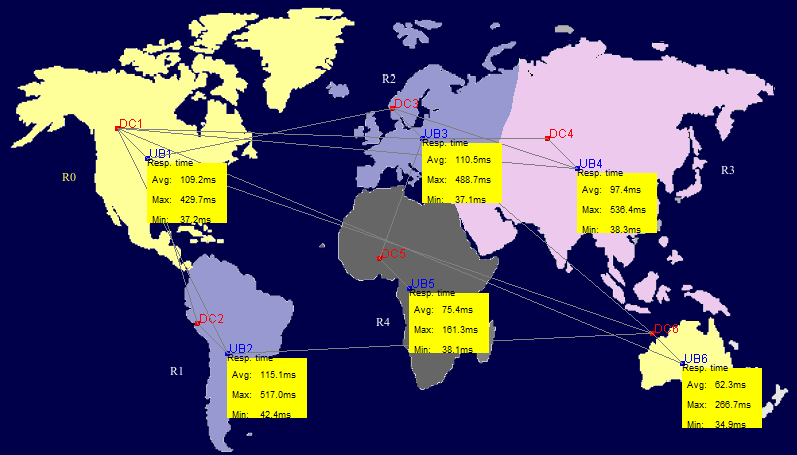
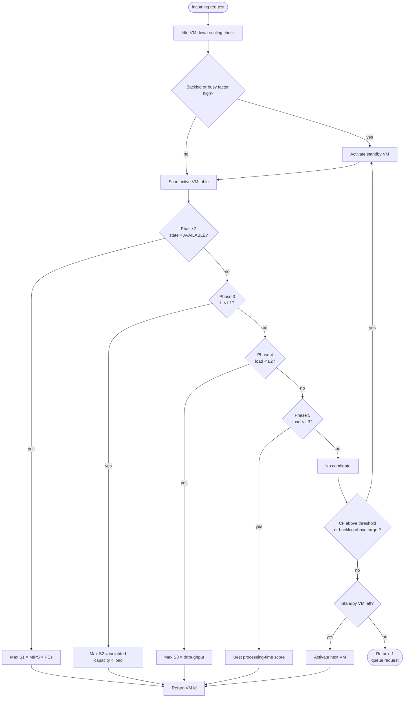

# Throttled-ESCE Hybrid Load Balancer

**A cost-efficient, capacity-aware load balancer for heterogeneous clouds — reference implementation and CloudAnalyst experiments.**

[](https://github.com/kopolart/throttled-esce-hybrid-lb/actions/workflows/build.yml)
[](LICENSE)
[](https://adoptium.net/)
[](https://github.com/kopolart/throttled-esce-hybrid-lb)

This repository packages the full CloudAnalyst simulator source together with a hybrid VM load balancer that fuses Throttled Load Balancing (TLB) with Equally Spread Current Execution (ESCE). It adds tri-level load thresholds, capacity-aware scoring and cost-aware elastic scaling, and it ships the complete experimental setup plus the CloudAnalyst reports for all three evaluated scenarios.

---

## Highlights

- **Hybrid policy** — TLB's state-aware VM table combined with ESCE's load-spreading, extended with capacity-aware scoring.
- **Tri-level load thresholds** — every VM is classified into low, medium or high load before allocation.
- **Seven-phase selection** — idle → low-load → medium-load → high-load → elastic scaling → overload guard.
- **Cost-aware scaling** — idle VMs are returned to standby, with an explicit active-VM floor.
- **Scenario presets** — thresholds, idle timers and CPU/RAM weights are read from a properties file at start-up.
- **Reproducible evidence** — all 12 CloudAnalyst reports (3 scenarios × 4 policies) are archived in [`results/`](results).

### Results at a glance

| Metric | Improvement vs ESCE / TLB |
|---|---:|
| Average processing time | **-32.56%** |
| Average response time | **-8.05%** |
| VM cost | **-53.03%** |
| Total cost | **-4.36%** |
| Requests routed to high-capacity VMs | **> 44.39%** |



*Response-time map from a 24-hour scenario-3 run: six user bases served by six data centres, with average, maximum and minimum response time per user base.*

Full tables: [docs/results.md](docs/results.md)

---

## Architecture



The state machine, equations and pseudocode are documented in [docs/method.md](docs/method.md).

---

## The seven phases

| Phase | Condition | Selection |
|---|---|---|
| 1 | VM pool start-up | Sort by capacity; low-capacity VMs serve first, the rest stay on standby |
| 2 | L<sub>i</sub> = 0, `AVAILABLE` | Highest S<sub>1</sub> = MIPS<sub>i</sub> × PEs<sub>i</sub> |
| 3 | L<sub>i</sub> < L<sub>1</sub> | Highest S<sub>2</sub> — weighted capacity divided by current load |
| 4 | L<sub>1</sub> ≤ L<sub>i</sub> < L<sub>2</sub> | Highest observed throughput S<sub>3</sub> |
| 5 | L<sub>2</sub> ≤ L<sub>i</sub> < L<sub>3</sub> | Best bounded processing-time score S<sub>4</sub> |
| 6 | No candidate | Activate a standby VM when CF or BF exceeds its guard; deactivate VMs idle beyond their threshold |
| 7 | No candidate and no standby | Return `-1`; the controller queues the request |

Selection priority is **Phase 2 → 3 → 4 → 5**. Any successful allocation resets the consecutive-failure counter.

### Scoring equations

<p align="center"><b>S<sub>1</sub>(i) = MIPS<sub>i</sub> × PEs<sub>i</sub></b></p>

<p align="center"><b>S<sub>2</sub>(i) = [ w · (MIPS<sub>i</sub> / MIPS<sub>max</sub>) + (1 − w) · (RAM<sub>i</sub> / RAM<sub>max</sub>) ] ÷ max(L<sub>i</sub>, ε)</b></p>

<p align="center"><b>S<sub>3</sub>(i) = C<sub>i</sub> ÷ Σ<sub>k</sub> A<sub>i,k</sub></b></p>

<p align="center"><b>S<sub>4</sub>(i) = (1 / m) · Σ<sub>k</sub> T<sub>i,k</sub></b></p>

<p align="center"><b>BF = n / m</b></p>

where L<sub>i</sub> is the number of tasks running on VM i, C<sub>i</sub> is its completed-task count, A<sub>i,k</sub> is the active time of task k, T<sub>i,k</sub> is its processing time, n is the number of busy active VMs, m is the number of active VMs, and w is the CPU weight (RAM weight is 1 − w).

---

## Scenario presets

[`config/loadbalancer.properties`](config/loadbalancer.properties) ships the three presets used for the archived experiments:

| Parameter | Scenario 1 | Scenario 2 | Scenario 3 |
|---|---:|---:|---:|
| Low threshold L<sub>1</sub> | 30 | 27 | 4 |
| Medium threshold L<sub>2</sub> | 40 | 36 | 32 |
| High threshold L<sub>3</sub> | 50 | 45 | 40 |
| Idle threshold | 120 s | 180 s | 300 s |
| CPU / RAM weight | 0.8 / 0.2 | 0.8 / 0.2 | 0.8 / 0.2 |

Selecting a scenario is a single flag:

```bash
java -Dlb.scenario=3 -cp "build/classes:jars/*" cloudsim.ext.gui.GuiMain
```

The loader resolves `-Dlb.config` → `config/loadbalancer.properties` → classpath → built-in presets, validates L<sub>1</sub> < L<sub>2</sub> < L<sub>3</sub>, and logs the effective parameters. See [docs/configuration.md](docs/configuration.md).

---

## Repository layout

```text
throttled-esce-hybrid-lb/
├── src/                                   CloudAnalyst source
│   ├── cloudsim/ext/datacenter/
│   │   ├── ProposedMethodLoadBalancer.java  hybrid policy (Phases 1-7)
│   │   ├── LoadBalancerConfig.java          scenario-preset loader
│   │   ├── ThrottledVmLoadBalancer.java      baseline TLB
│   │   ├── ActiveVmLoadBalancer.java         baseline ESCE
│   │   ├── RoundRobinVmLoadBalancer.java     baseline RR
│   │   └── DatacenterController.java         allocation + cost model
│   └── resources/                            maps, delay and bandwidth matrices
├── config/loadbalancer.properties          experiment parameters
├── docs/
│   ├── method.md                            equations, phases, state machine
│   ├── configuration.md                     keys, resolution order, validation
│   ├── reproducibility.md                   full CloudAnalyst setup tables
│   ├── results.md                           all metric tables
│   └── images/                              CloudAnalyst screenshots
├── results/
│   ├── scenario-1/                          CloudAnalyst reports (4 policies)
│   ├── scenario-2/
│   ├── scenario-3/
│   └── logs/                                simulator console logs
├── test/                                    headless configuration checks
├── scripts/                                 build and run helpers
├── jars/                                    CloudSim / GridSim / SimJava / iText
├── build.xml, .project, .classpath          Ant, Eclipse and NetBeans metadata
└── .github/workflows/build.yml              CI compile + config test
```

---

## Quick start

### Requirements

- Java 8 (JDK for building; JRE is enough for running)
- No external dependencies beyond the jars bundled in [`jars/`](jars)

### Build

```bash
# Linux / macOS / Git Bash
./scripts/build.sh
```

```bat
:: Windows
scripts\build.bat
```

Or import the folder into Eclipse (**File → Import → Existing Projects**) or NetBeans and build with Ant.

### Run

```bash
# Scenario 1, 2 or 3
./scripts/run.sh 1
./scripts/run.sh 2
./scripts/run.sh 3
```

```bat
scripts\run.bat 3
```

In the CloudAnalyst **Advanced** tab choose **Proposed Method** as the load balancing policy.

### Verify the configuration

```bash
./scripts/test.sh
```

The headless test checks all three scenario presets, the built-in fallbacks and the `auto` scenario heuristic.

---

## Reproducing the experiments

The complete CloudAnalyst setup — user bases, data centres, physical servers, VM classes, cost model, instruction lengths and run procedure — is recorded in [docs/reproducibility.md](docs/reproducibility.md).

Summary:

1. Build the project.
2. Create the three scenarios exactly as tabulated.
3. Use **Optimize Response Time** as the service broker policy.
4. Run **Proposed Method**, **Throttled**, **ESCE** and **Round Robin** for 24 simulated hours.
5. Compare against the archived reports in [`results/`](results).

---

## Status and scope

This is an event-driven simulator implementation, not a production load balancer. The balancer relies on the CloudAnalyst/CloudSim clock, VM state table and cost accounting. The configuration loader and algorithm are kept deliberately small so the allocation behaviour can be audited line by line.

**Known limitations:**

- Load is measured as the **number of tasks**, not their computational weight; a few heavy tasks can produce latency outliers.
- Storage I/O and network bandwidth are not yet part of the selection score.
- Scenario selection is explicit by default; the `auto` heuristic can misclassify the overlapping VM ranges of scenarios 2 and 3.

---

## Contact

[contact.yousefi@gmail.com](mailto:contact.yousefi@gmail.com)

---

## License and acknowledgements

The hybrid balancer, configuration, documentation and experimental reports are released under the [MIT License](LICENSE).

The simulator is built on **CloudAnalyst** and **CloudSim** (Buyya et al.), with **GridSim** and **SimJava** runtime libraries. The upstream simulator code and bundled jars retain their original attribution; the MIT license applies to the hybrid balancer, its configuration, the documentation and the experiment artifacts added in this repository.

If you use this code or the results, please cite the repository — see [CITATION.cff](CITATION.cff).
