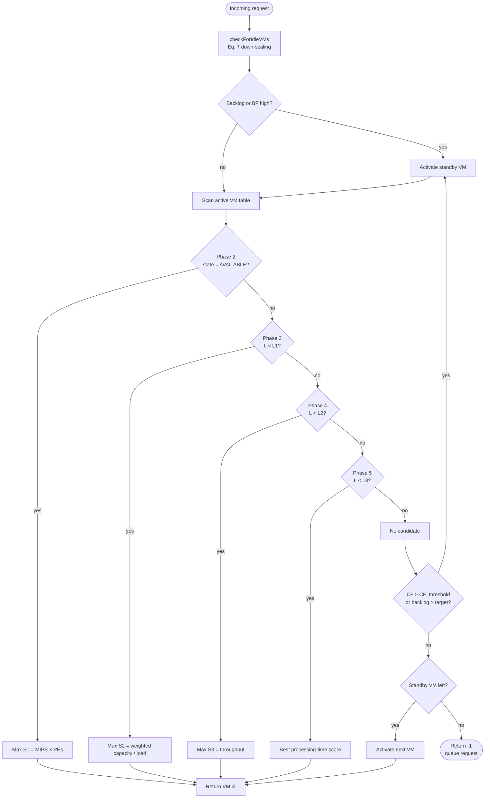

# Throttled-ESCE Hybrid Load Balancer

**A cost-efficient, capacity-aware load balancer for heterogeneous clouds — reference implementation and CloudAnalyst experiments.**

[](https://github.com/kopolart/throttled-esce-hybrid-lb/actions/workflows/build.yml)
[](LICENSE)
[](https://adoptium.net/)
[](https://github.com/kopolart/throttled-esce-hybrid-lb)
[](paper/cost-efficient-hybrid-load-balancer.pdf)

This repository contains the complete artifact for the paper:

> **A Cost-Efficient Hybrid Load Balancer Using Throttled-ESCE Synthesis and Tri-level Load Thresholds for Heterogeneous Clouds**  
> Ali Yousefi Choubini — Shahid Ashrafi Esfahani University, Isfahan, Iran.

It packages the full CloudAnalyst simulator source, the proposed balancer, the exact parameter set from the paper, the manuscript, and the CloudAnalyst reports for all three experimental scenarios.

---

## Highlights

- **Hybrid policy** — TLB's state-aware VM table combined with ESCE's load-spreading, extended with capacity-aware scoring.
- **Tri-level load thresholds** — every VM is classified into low, medium or high load before allocation.
- **Seven-phase selection** — idle → low-load → medium-load → high-load → elastic scaling → overload guard.
- **Cost-aware scaling** — idle VMs are returned to standby, with an explicit active-VM floor.
- **Paper-exact configuration** — thresholds, idle timers and CPU/RAM weights are read from a properties file matching Table 6.
- **Reproducible evidence** — all 12 CloudAnalyst reports (3 scenarios × 4 policies) are archived in [`results/`](results).

### Results at a glance

| Metric | Improvement vs ESCE / TLB |
|---|---:|
| Average processing time | **-32.56%** |
| Average response time | **-8.05%** |
| VM cost | **-53.03%** |
| Total cost | **-4.36%** |
| Requests routed to high-capacity VMs | **> 44.39%** |

Full tables: [docs/results.md](docs/results.md)

---

## Architecture



The state machine, equations and pseudocode are documented in [docs/method.md](docs/method.md).

---

## The seven phases

| Phase | Condition | Selection | Paper |
|---|---|---|---|
| 1 | VM pool start-up | Sort by capacity; low-capacity VMs serve first, the rest stay on standby | Sec. 3.1 |
| 2 | $L_i = 0$, `AVAILABLE` | Max $S_1 = \mathrm{MIPS}_i \times \mathrm{PEs}_i$ | Eq. (2) |
| 3 | $L_i < L_1$ | Max weighted capacity over load, $S_2$ | Eq. (3) |
| 4 | $L_1 \le L_i < L_2$ | Max observed throughput, $S_3$ | Eq. (4) |
| 5 | $L_2 \le L_i < L_3$ | Best processing-time score ($S_4$) | Eq. (5) |
| 6 | No candidate | Activate a standby VM when $CF$ or $BF$ exceeds its guard; deactivate VMs idle beyond $\tau$ | Eq. (6), (7) |
| 7 | No candidate and no standby | Return `-1`; the controller queues the request | Sec. 3.7 |

Selection priority is **Phase 2 → 3 → 4 → 5**. Any successful allocation resets the consecutive-failure counter.

---

## Paper-exact configuration

[`config/loadbalancer.properties`](config/loadbalancer.properties) contains Table 6 verbatim:

| Parameter | Scenario 1 | Scenario 2 | Scenario 3 |
|---|---:|---:|---:|
| Low threshold $L_1$ | 30 | 27 | 4 |
| Medium threshold $L_2$ | 40 | 36 | 32 |
| High threshold $L_3$ | 50 | 45 | 40 |
| Idle threshold | 120 s | 180 s | 300 s |
| CPU / RAM weight | 0.8 / 0.2 | 0.8 / 0.2 | 0.8 / 0.2 |

Selecting a scenario is a single flag:

```bash
java -Dlb.scenario=3 -cp "build/classes:jars/*" cloudsim.ext.gui.GuiMain
```

The loader resolves `-Dlb.config` → `config/loadbalancer.properties` → classpath → built-in paper defaults, validates `L1 < L2 < L3`, and logs the effective parameters. See [docs/configuration.md](docs/configuration.md).

---

## Repository layout

```text
throttled-esce-hybrid-lb/
├── src/                                   CloudAnalyst source
│   ├── cloudsim/ext/datacenter/
│   │   ├── ProposedMethodLoadBalancer.java  hybrid policy (Phases 1-7)
│   │   ├── LoadBalancerConfig.java          Table 6 configuration loader
│   │   ├── ThrottledVmLoadBalancer.java      baseline TLB
│   │   ├── ActiveVmLoadBalancer.java         baseline ESCE
│   │   ├── RoundRobinVmLoadBalancer.java     baseline RR
│   │   └── DatacenterController.java         allocation + cost model
│   └── resources/                            maps, delay and bandwidth matrices
├── config/loadbalancer.properties          experiment parameters (Table 6)
├── paper/                                  manuscript PDF + editable DOCX
├── docs/
│   ├── method.md                            equations, phases, state machine
│   ├── configuration.md                     keys, resolution order, validation
│   ├── reproducibility.md                   full CloudAnalyst setup tables
│   └── results.md                           all metric tables
├── results/
│   ├── scenario-1/                          CloudAnalyst reports (4 policies)
│   ├── scenario-2/
│   ├── scenario-3/
│   └── logs/                                simulator console logs
├── test/                                    headless configuration checks
├── scripts/                                 build and run helpers
├── jars/                                    CloudSim / GridSim / SimJava / iText
├── build.xml, .project, .classpath          Ant, Eclipse and NetBeans metadata
└── .github/workflows/build.yml              CI compile + config test
```

---

## Quick start

### Requirements

- Java 8 (JDK for building; JRE is enough for running)
- No external dependencies beyond the jars bundled in [`jars/`](jars)

### Build

```bash
# Linux / macOS / Git Bash
./scripts/build.sh
```

```bat
:: Windows
scripts\build.bat
```

Or import the folder into Eclipse (**File → Import → Existing Projects**) or NetBeans and build with Ant.

### Run

```bash
# Scenario 1, 2 or 3
./scripts/run.sh 1
./scripts/run.sh 2
./scripts/run.sh 3
```

```bat
scripts\run.bat 3
```

In the CloudAnalyst **Advanced** tab choose **Proposed Method** as the load balancing policy.

### Verify the configuration

```bash
./scripts/test.sh
```

The headless test checks all three Table 6 parameter sets, the built-in fallbacks and the `auto` scenario heuristic.

---

## Reproducing the experiments

The complete CloudAnalyst setup — user bases, data centres, physical servers, VM classes, cost model, instruction lengths and run procedure — is recorded in [docs/reproducibility.md](docs/reproducibility.md).

Summary:

1. Build the project.
2. Create the three scenarios exactly as tabulated.
3. Use **Optimize Response Time** as the service broker policy.
4. Run **Proposed Method**, **Throttled**, **ESCE** and **Round Robin** for 24 simulated hours.
5. Compare against the archived reports in [`results/`](results).

---

## Paper

| Artifact | File |
|---|---|
| Manuscript (PDF, 17 pages) | [cost-efficient-hybrid-load-balancer.pdf](paper/cost-efficient-hybrid-load-balancer.pdf) |
| Editable source | [cost-efficient-hybrid-load-balancer.docx](paper/source/cost-efficient-hybrid-load-balancer.docx) |
| Method documentation | [docs/method.md](docs/method.md) |

```bibtex
@article{yousefi2026hybridlb,
  author  = {Yousefi Choubini, Ali},
  title   = {A Cost-Efficient Hybrid Load Balancer Using Throttled-ESCE Synthesis
             and Tri-level Load Thresholds for Heterogeneous Clouds},
  journal = {Manuscript submitted for publication},
  year    = {2026},
  note    = {Reference implementation: https://github.com/kopolart/throttled-esce-hybrid-lb}
}
```

A machine-readable record is provided in [CITATION.cff](CITATION.cff).

---

## Status and scope

This is a research artifact, not a production load balancer. The balancer is designed for the CloudAnalyst/CloudSim event model and uses the simulator's clock, VM state table and cost accounting. The configuration loader and algorithm are kept deliberately small so the paper's behaviour can be audited line by line.

**Known limitations** (also discussed in the paper):

- Load is measured as the **number of tasks**, not their computational weight; a few heavy tasks can produce latency outliers.
- Storage I/O and network bandwidth are not yet part of the selection score.
- Scenario selection is explicit by default; the `auto` heuristic can misclassify the overlapping VM ranges of scenarios 2 and 3.

---

## Author

**Ali Yousefi Choubini**  
PhD student in Software Engineering, Islamic Azad University, Isfahan Branch, Iran  
Lecturer, Sepahan Institute of Higher Education and Shahid Ashrafi Esfahani University  
[a.yousofi@ashrafi.ac.ir](mailto:a.yousofi@ashrafi.ac.ir) · [contact.yousefi@gmail.com](mailto:contact.yousefi@gmail.com)  
GitHub: [@kopolart](https://github.com/kopolart)

---

## License and acknowledgements

The proposed method, configuration, documentation and experimental reports are released under the [MIT License](LICENSE).

The simulator is built on **CloudAnalyst** and **CloudSim** (Buyya et al.), with **GridSim** and **SimJava** runtime libraries. The upstream simulator code and bundled jars retain their original attribution; the MIT license applies to the hybrid balancer, its configuration, the documentation and the experiment artifacts added in this repository.

If you use this code or the results, please cite the paper above.
