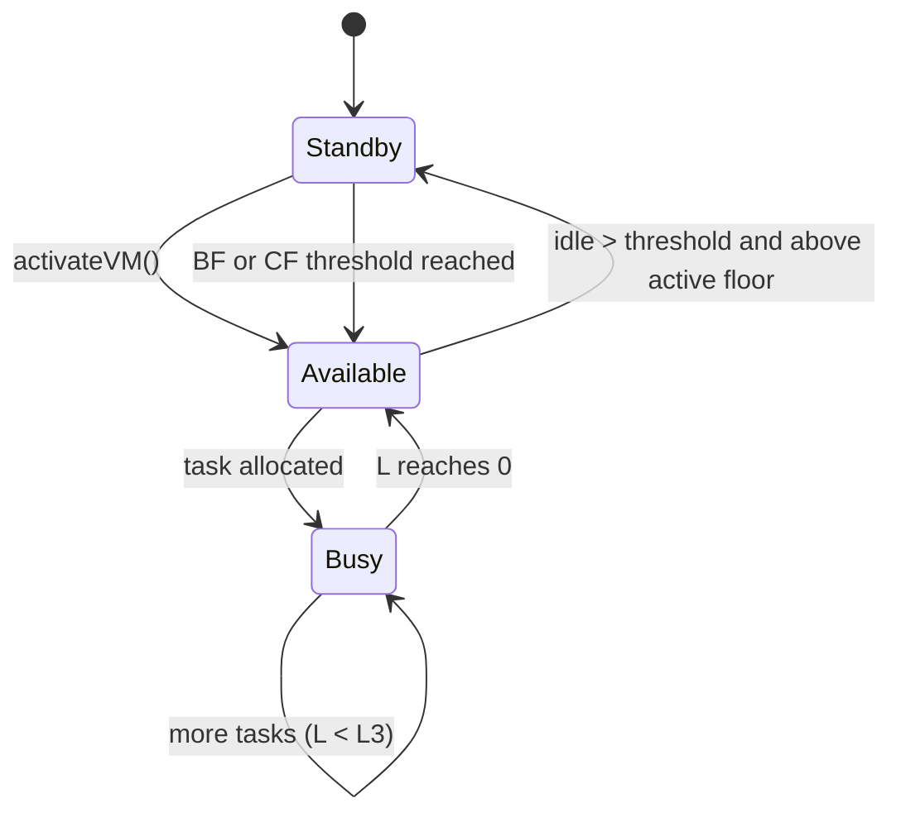

# Method

**Throttled-ESCE Hybrid Load Balancer for heterogeneous clouds**

The balancer fuses the state-aware VM table of Throttled Load Balancing (TLB) with the distributed load-spreading policy of Equally Spread Current Execution (ESCE), then extends both with capacity-aware scoring, tri-level load thresholds and elastic cost-aware scaling.

Implementation: [`ProposedMethodLoadBalancer.java`](../src/cloudsim/ext/datacenter/ProposedMethodLoadBalancer.java)  
Runtime parameters: [`LoadBalancerConfig.java`](../src/cloudsim/ext/datacenter/LoadBalancerConfig.java) and [`config/loadbalancer.properties`](../config/loadbalancer.properties)

---

## 1. Motivation

| Algorithm | Strength | Limitation addressed by the hybrid |
|---|---|---|
| **TLB** | O(1)-style state table; assigns only idle VMs | Ignores capacity and current load; one task per VM; first-idle bias |
| **ESCE** | Spreads tasks evenly across VMs | Ignores heterogeneous VM capacity; equalises counts, not work |

The hybrid keeps a live VM state table, allows multiple concurrent tasks per VM, and ranks candidates by processing power, memory, current load, throughput and historical processing time.

---

## 2. Notation

| Symbol | Meaning |
|---|---|
| L<sub>i</sub> | Number of tasks currently executing on VM i |
| L<sub>1</sub>, L<sub>2</sub>, L<sub>3</sub> | Low, medium and high load thresholds, with 1 ≤ L<sub>1</sub> < L<sub>2</sub> < L<sub>3</sub> |
| MIPS<sub>i</sub> | Million instructions per second of VM i |
| PEs<sub>i</sub> | Number of processing elements (vCPUs) of VM i |
| RAM<sub>i</sub> | Memory of VM i |
| w | CPU/MIPS weight, 0 ≤ w ≤ 1; the RAM weight is 1 − w |
| ε | Small numerical-stability constant |
| CF | Consecutive-failure counter |
| BF | Busy factor, BF = n / m |
| Δt<sup>idle</sup><sub>i</sub> | Idle duration of VM i |
| τ<sub>i</sub> | Idle threshold of VM i |

The tri-level threshold partitions active VMs into four selection bands:

```text
low load          medium load        high load          not eligible
[0, L1)           [L1, L2)           [L2, L3)           [L3, ∞)
```

A request is only placed on a VM whose current load is below L<sub>3</sub>; otherwise no candidate is eligible.

---

## 3. Selection scores

### Phase 2 — idle VM processing power

<p align="center"><b>S<sub>1</sub>(i) = MIPS<sub>i</sub> × PEs<sub>i</sub></b></p>

The strongest idle VM wins. An idle VM has L<sub>i</sub> = 0 and state `AVAILABLE`.

### Phase 3 — low-load processing capacity

<p align="center"><b>S<sub>2</sub>(i) = [ w · (MIPS<sub>i</sub> / MIPS<sub>max</sub>) + (1 − w) · (RAM<sub>i</sub> / RAM<sub>max</sub>) ] ÷ max(L<sub>i</sub>, ε)</b></p>

The numerator is the weighted, normalised capacity of the VM; the denominator penalises current load. The VM with the largest S<sub>2</sub> wins. The default weights are w = 0.8 for CPU and 1 − w = 0.2 for RAM.

### Phase 4 — medium-load throughput

<p align="center"><b>S<sub>3</sub>(i) = C<sub>i</sub> ÷ Σ<sub>k</sub> A<sub>i,k</sub></b></p>

C<sub>i</sub> is the number of completed tasks on VM i and the denominator is the total active time of that VM. The VM with the highest observed throughput wins.

### Phase 5 — high-load mean processing time

<p align="center"><b>S<sub>4</sub>(i) = (1 / m) · Σ<sub>k</sub> T<sub>i,k</sub></b></p>

The VMs in the high-load band are ranked by a bounded processing-time/load score and the largest score is selected; the exact score used by the implementation is documented in [Implementation notes](#8-implementation-notes).

### Elastic scaling — busy factor

<p align="center"><b>BF = n / m, &nbsp;&nbsp; 0 ≤ n ≤ m</b></p>

n is the number of busy active VMs and m is the number of active VMs. When BF exceeds its threshold, or CF exceeds its threshold, a standby VM is activated.

### Cost-aware down-scaling

<p align="center"><b>v ∈ activeVMs ∩ highCapacityVMs &nbsp;∧&nbsp; Δt<sup>idle</sup><sub>v</sub> ≥ τ<sub>v</sub> &nbsp;⇒&nbsp; v ∉ activeVMs</b></p>

High-capacity VMs that remain idle longer than their idle threshold are returned to the standby list; low- and medium-capacity VMs are kept for cheap burst absorption.

---

## 4. Seven-phase algorithm

```text
GET_NEXT_VM():
  // Down-scaling first
  for each active, idle VM with Δt_idle > τ and L = 0:
      if activeVMs > active-floor:
          deactivate longest-idle VM      // one per cycle, avoids oscillation

  // Up-scaling guard
  if queue_backlog > max(20, active_target / 3) or BF > BF_threshold:
      activate one standby VM

  best ← none
  for each active VM i:
      if state(i) = AVAILABLE:                       // Phase 2
          S1 = MIPS_i × PEs_i;          keep max
      else if L_i < L1:                              // Phase 3
          S2 = capacity_score(i);       keep max
      else if L_i < L2:                              // Phase 4
          S3 = throughput(i);           keep max
      else if L_i < L3:                              // Phase 5
          S4 = processing_score(i);     keep max

  if a candidate exists:
      CF ← 0; allocate(candidate); return candidate  // priority 2 → 3 → 4 → 5

  CF ← CF + 1
  if CF > CF_threshold or queue_backlog > active_target:
      activate a batch of standby VMs (1, 3 or 5 by pressure)

  if standby VMs remain:                             // Phase 6
      activate next standby VM; CF ← 0; return it

  return -1                                          // Phase 7: queue the request
```

On allocation the VM becomes `BUSY` and its task counter increases. On completion the counter decreases, the VM returns to `AVAILABLE` when the counter reaches zero, and the observed processing time updates the VM's history. Any successful allocation resets CF to zero.

---

## 5. State machine



`vmStatesList` is the shared TLB-style table owned by the data-centre controller. Standby VMs are removed from it, so the controller cannot allocate to them until the hybrid balancer activates them.

---

## 6. Allocation flow in CloudAnalyst

1. `DatacenterController.submitNewCloudlet()` calls `loadBalancer.getNextAvailableVm()`.
2. The balancer returns a VM id or `-1`.
3. A non-negative id triggers `submitCloudlet()` and fires `EVENT_CLOUDLET_ALLOCATED_TO_VM`; the balancer marks the VM busy and increments counters.
4. `-1` parks the request in `waitingQueue` until a VM completes (Phase 7).
5. On completion, `EVENT_VM_FINISHED_CLOUDLET` updates counters, processing-time history and the availability state.

---

## 7. Cost model

CloudAnalyst charges each VM for the time it stays allocated:

<p align="center"><b>Cost<sub>i</sub> = Rate<sub>i</sub> × Duration<sub>i</sub></b></p>

<p align="center"><b>Total Cost = Σ<sub>i</sub> Cost<sub>i</sub> + DataTransferCost</b></p>

Duration is the wall-clock span between VM creation and release, expressed in hours. `DatacenterController.getVmCost()` applies tiered multipliers (1.0, 1.3, 1.6) to the 1-, 2- and 4-vCPU VM classes so that high-capacity instances cost more per hour, while `getDataTransferCost()` bills the accumulated payload at the configured per-GB rate.

---

## 8. Implementation notes

- **Configuration is authoritative.** All scenario thresholds, the idle threshold and the CPU/RAM weights are read at load-balancer construction time. Invalid thresholds are rejected and replaced with the built-in preset values, with a console warning.
- **Scenario selection.** `-Dlb.scenario=1|2|3` overrides `lb.scenario` in the properties file. `auto` uses a VM-count heuristic (≤ 10 → 1, ≤ 16 → 2, otherwise 3); because the scenario VM ranges overlap, explicit selection is recommended for reproducibility.
- **Normalisation.** MIPS<sub>max</sub> and RAM<sub>max</sub> are computed over all provisioned VMs, including those on standby, so S<sub>2</sub> is scale-invariant and does not depend on which VMs happen to be active.
- **Phase 5 score.** The implementation keeps a bounded score `0.4 / (meanProcessingTime + 1) + 0.6 / (L + 1)` and maximises it. The configurable thresholds determine which VMs enter this band.
- **Down-scaling scope.** The implementation deactivates the longest-idle active VM while respecting the active-VM floor. Both the high-capacity-only rule and the active floor are governed by the idle threshold from the active scenario preset.
- **Time units.** CloudSim's clock is in seconds; CloudAnalyst reports response and processing times in milliseconds. The scoring code operates on CloudSim clock units, consistent with the simulator's event timeline.
- **Threading.** CloudAnalyst runs a single simulation event thread; the allocation-count map is synchronised defensively because it is also read by reporting code.

---

## 9. Performance metrics

The archived CloudAnalyst reports provide processing time (average, minimum, maximum), response time, the share of requests routed to each VM class, VM cost, data-transfer cost and total cost. The measured values and the aggregate improvement are summarised in [results.md](results.md).
