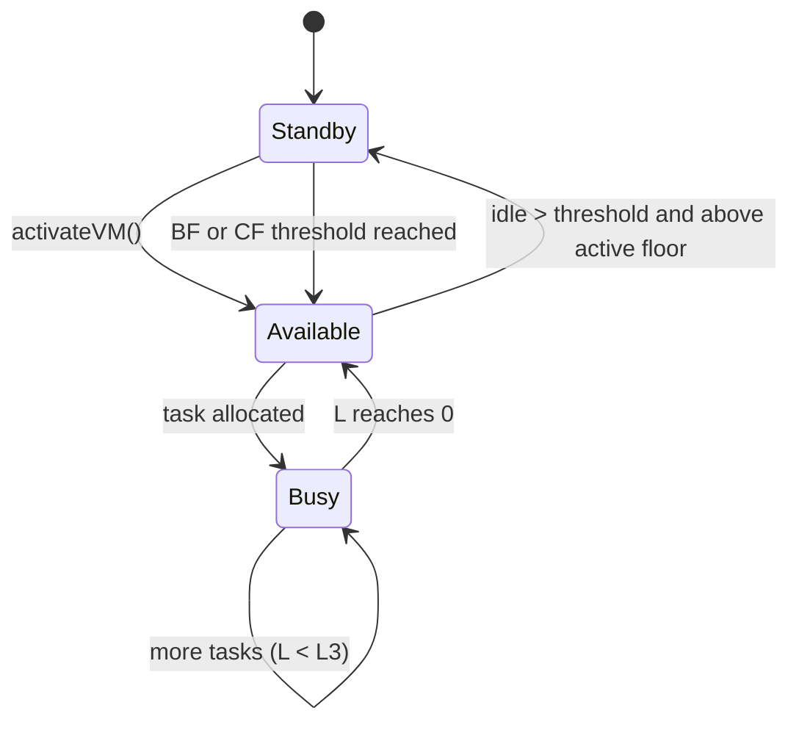

# Method

**A Cost-Efficient Hybrid Load Balancer Using Throttled-ESCE Synthesis and Tri-Level Load Thresholds for Heterogeneous Clouds**

The proposed balancer fuses the state-aware VM table of Throttled Load Balancing (TLB) with the distributed load-spreading policy of Equally Spread Current Execution (ESCE), then extends both with capacity-aware scoring, a tri-level load threshold, and elastic cost-aware scaling.

Reference implementation: [`ProposedMethodLoadBalancer.java`](../src/cloudsim/ext/datacenter/ProposedMethodLoadBalancer.java)  
Runtime parameters: [`LoadBalancerConfig.java`](../src/cloudsim/ext/datacenter/LoadBalancerConfig.java) and [`config/loadbalancer.properties`](../config/loadbalancer.properties)

---

## 1. Motivation

| Algorithm | Strength | Limitation addressed by the hybrid |
|---|---|---|
| **TLB** | O(1)-style state table; assigns only idle VMs | Ignores capacity and current load; one task per VM; first-idle bias |
| **ESCE** | Spreads tasks evenly across VMs | Ignores heterogeneous VM capacity; equalises counts, not work |

The hybrid keeps a live VM state table, allows multiple concurrent tasks per VM, and ranks candidates by processing power, memory, current load, throughput, and historical processing time.

---

## 2. Notation

| Symbol | Meaning |
|---|---|
| $L_i$ | Number of tasks currently executing on VM $i$ |
| $L_1, L_2, L_3$ | Low, medium and high load thresholds, with $1 \le L_1 < L_2 < L_3$ |
| $\mathrm{MIPS}_i$ | Million instructions per second of VM $i$ |
| $\mathrm{PEs}_i$ | Number of processing elements (vCPUs) of VM $i$ |
| $\mathrm{RAM}_i$ | Memory of VM $i$ |
| $w$ | CPU/MIPS weight, $0 \le w \le 1$; RAM weight is $1-w$ |
| $\varepsilon$ | Small numerical-stability constant |
| $CF$ | Consecutive-failure counter |
| $BF$ | Busy factor, $BF = n/m$ |
| $\Delta t^{\mathrm{idle}}_i$ | Idle duration of VM $i$ |
| $\tau_i$ | Idle threshold of VM $i$ |

The tri-level threshold partitions active VMs into four selection bands:

$$
\underbrace{[0, L_1)}_{\text{low load}}\quad
\underbrace{[L_1, L_2)}_{\text{medium load}}\quad
\underbrace{[L_2, L_3)}_{\text{high load}}\quad
\underbrace{[L_3, \infty)}_{\text{not eligible}}
$$

A request is only placed on a VM whose current load is below $L_3$, which is the overload guard of Phase 7.

---

## 3. Selection scores

### Phase 2 - idle VM processing power

$$
S_1(i) = \mathrm{MIPS}_i \times \mathrm{PEs}_i
\tag{2}
$$

The strongest idle VM wins. An idle VM has $L_i = 0$ and state `AVAILABLE`.

### Phase 3 - low-load processing capacity

$$
S_2(i) =
\frac{
w \cdot \dfrac{\mathrm{MIPS}_i}{\mathrm{MIPS}_{\max}}
+ (1-w) \cdot \dfrac{\mathrm{RAM}_i}{\mathrm{RAM}_{\max}}
}{
\max(L_i, \varepsilon)
}
\tag{3}
$$

The numerator is the weighted, normalised capacity of the VM; the denominator penalises current load. The VM with the largest $S_2$ wins. The paper uses $w = 0.8$ for CPU and $1-w = 0.2$ for RAM.

### Phase 4 - medium-load throughput

$$
S_3(i) =
\frac{C_i}{\sum_{k=1}^{M_i} T^{\mathrm{active}}_{i,k}}
\tag{4}
$$

$C_i$ is the number of completed tasks on VM $i$ and the denominator is the total active time of that VM. The VM with the highest observed throughput wins.

### Phase 5 - high-load mean processing time

$$
S_4(i) = \frac{1}{m}\sum_{k=1}^{m} T^{k}_{i}
\tag{5}
$$

The paper selects the VM with the **minimum** mean processing time among VMs with $L_i < L_3$. The reference implementation ranks candidates with a bounded processing-time/load score and takes the maximum; see [Implementation notes](#8-implementation-notes).

### Elastic scaling - busy factor

$$
BF = \frac{n}{m}, \qquad 0 \le n \le m
\tag{6}
$$

$n$ is the number of busy active VMs and $m$ the number of active VMs. When $BF$ exceeds its threshold, or $CF$ exceeds its threshold, a standby VM is activated.

### Cost-aware down-scaling

$$
\forall v \in \text{activeVMs} \cap \text{highCapacityVMs}:\;
\left(\Delta t^{\mathrm{idle}}_v \ge \tau_v\right) \Rightarrow v \notin \text{activeVMs}
\tag{7}
$$

High-capacity VMs that remain idle longer than their idle threshold are returned to the standby list; low- and medium-capacity VMs are kept for cheap burst absorption.

---

## 4. Seven-phase algorithm

```text
GET_NEXT_VM():
  // Down-scaling first (Eq. 7)
  for each active, idle VM with Δt_idle > τ and L = 0:
      if activeVMs > active-floor:
          deactivate longest-idle VM      // one per cycle, avoids oscillation

  // Up-scaling guard (Eq. 6)
  if queue_backlog > max(20, active_target / 3) or BF > BF_threshold:
      activate one standby VM

  best ← none
  for each active VM i:
      if state(i) = AVAILABLE:                       // Phase 2
          S1 = MIPS_i × PEs_i;          keep max
      else if L_i < L1:                              // Phase 3
          S2 = eq3(i);                  keep max
      else if L_i < L2:                              // Phase 4
          S3 = throughput(i);           keep max
      else if L_i < L3:                              // Phase 5
          S4 = processing_score(i);     keep max

  if a candidate exists:
      CF ← 0; allocate(candidate); return candidate  // priority 2 → 3 → 4 → 5

  CF ← CF + 1
  if CF > CF_threshold or queue_backlog > active_target:
      activate a batch of standby VMs (1, 3 or 5 by pressure)

  if standby VMs remain:                             // Phase 6
      activate next standby VM; CF ← 0; return it

  return -1                                          // Phase 7: queue the request
```

On allocation the VM becomes `BUSY` and its task counter increases. On completion the counter decreases, the VM returns to `AVAILABLE` when the counter reaches zero, and the observed processing time updates the VM's history. Any successful allocation resets $CF$ to zero.

---

## 5. State machine



`vmStatesList` is the shared TLB-style table owned by the data-centre controller. Standby VMs are removed from it, so the controller cannot allocate to them until the hybrid balancer activates them.

---

## 6. Allocation flow in CloudAnalyst

1. `DatacenterController.submitNewCloudlet()` calls `loadBalancer.getNextAvailableVm()`.
2. The balancer returns a VM id or `-1`.
3. A non-negative id triggers `submitCloudlet()` and fires `EVENT_CLOUDLET_ALLOCATED_TO_VM`; the balancer marks the VM busy and increments counters.
4. `-1` parks the request in `waitingQueue` until a VM completes (Phase 7).
5. On completion, `EVENT_VM_FINISHED_CLOUDLET` updates counters, processing-time history and the availability state.

---

## 7. Cost model

The cost figures in the paper use CloudAnalyst's VM cost model:

$$
\mathrm{Cost}_i = \mathrm{PEs}_i \times \mathrm{CostPerHour}_i \times \mathrm{Duration}_i
\tag{12}
$$

$$
\mathrm{Cost}_i = \mathrm{CostPerHour}_i \times \mathrm{Duration}_i
\tag{13}
$$

$$
\mathrm{Total\ Cost} = \sum_{i=1}^{n}\mathrm{Cost}_i + \mathrm{DataTransferCost}
\tag{14}
$$

The repository's `DatacenterController.getVmCost()` applies tiered multipliers (1.0, 1.3, 1.6) to the 1-, 2- and 4-vCPU VM classes so that high-capacity instances cost more per hour, as described in the paper.

---

## 8. Implementation notes

- **Configuration is authoritative.** All numeric values from Table 6 are read at load-balancer construction time. Invalid thresholds are rejected and replaced with the paper values, with a console warning.
- **Scenario selection.** `-Dlb.scenario=1|2|3` overrides `lb.scenario` in the properties file. `auto` uses a VM-count heuristic (<= 10 -> 1, <= 16 -> 2, otherwise 3); because the paper's scenario VM ranges overlap, explicit selection is recommended for reproducibility.
- **Normalisation.** $\mathrm{MIPS}_{\max}$ and $\mathrm{RAM}_{\max}$ are computed over all provisioned VMs, including those on standby, so Eq. (3) is scale-invariant and does not depend on which VMs happen to be active.
- **Phase 5 score.** The reference implementation keeps a bounded score `0.4 / (meanProcessingTime + 1) + 0.6 / (L + 1)` and maximises it, instead of directly minimising the mean processing time. This reproduces the published experiments; the configurable thresholds determine which VMs enter this band.
- **Down-scaling scope.** The reference implementation deactivates the longest-idle active VM while respecting the active-VM floor. The high-capacity-only rule of Eq. (7) is the paper's stated policy; the relaxed rule was used for the reported cost reduction. Both are governed by the idle threshold from Table 6.
- **Time units.** CloudSim's clock is in seconds; CloudAnalyst reports response and processing times in milliseconds. The scoring code operates on CloudSim clock units, consistent with the simulator's event timeline.
- **Threading.** CloudAnalyst runs a single simulation event thread; the allocation-count map is synchronised defensively because it is also read by reporting code.

---

## 9. Performance metrics

Processing time (Eq. 8-9), response time (Eq. 10), load distribution (Eq. 11), VM cost (Eq. 12-13) and total cost (Eq. 14) are the metrics reported in the paper. The simulation evidence and aggregate improvements are summarised in [results.md](results.md).
