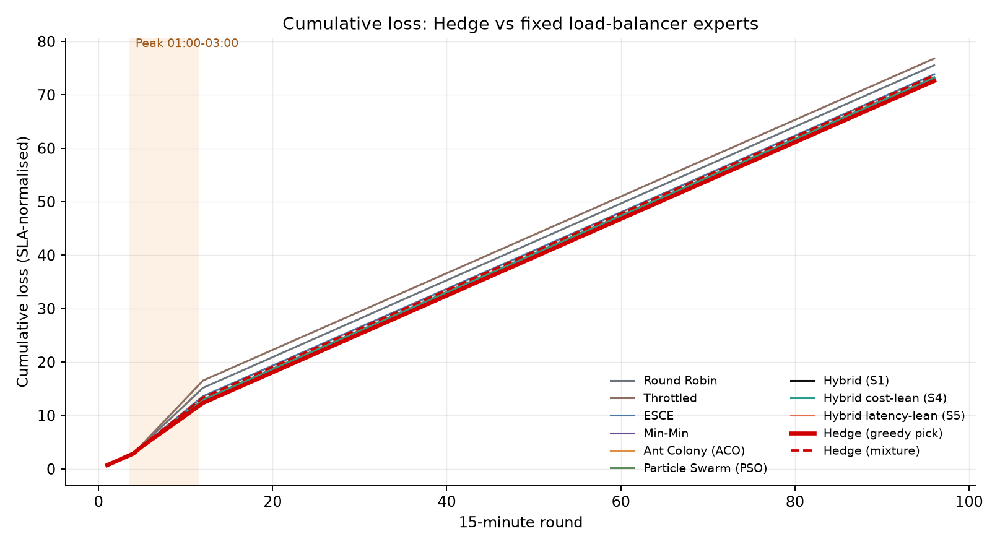
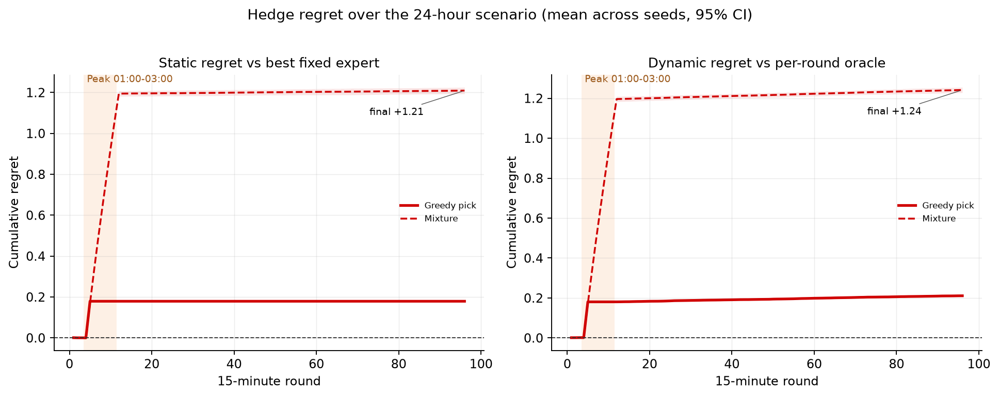
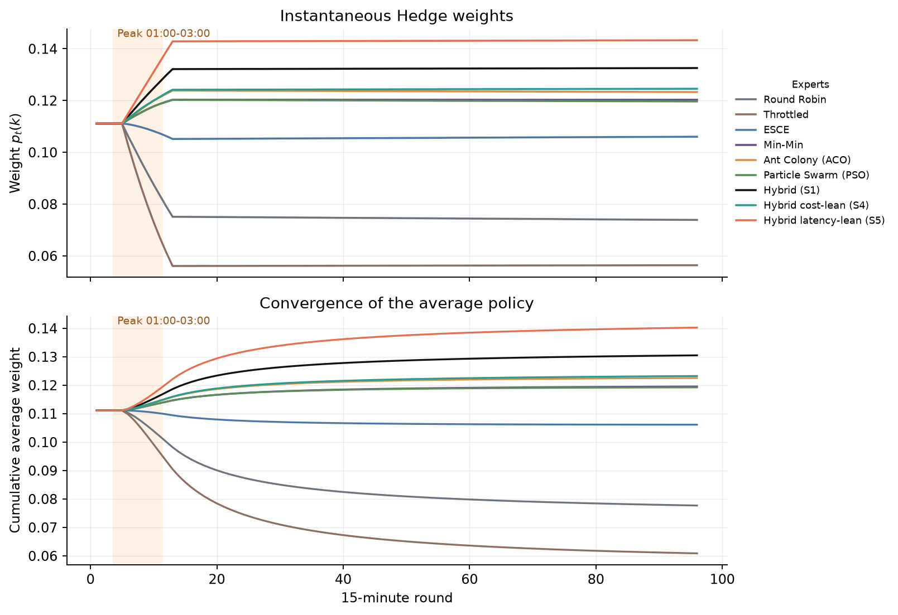
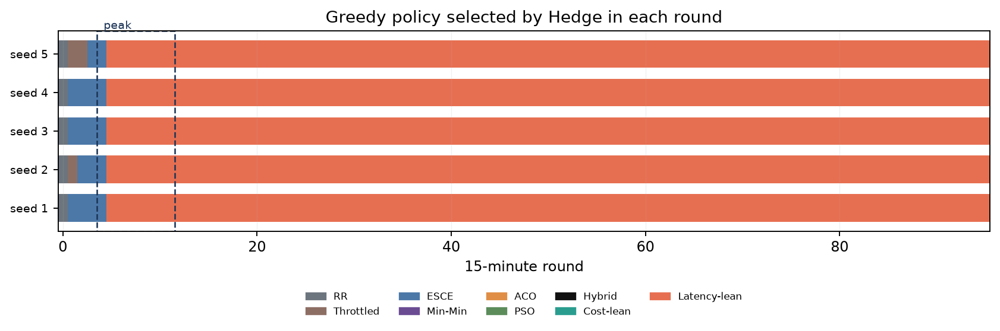
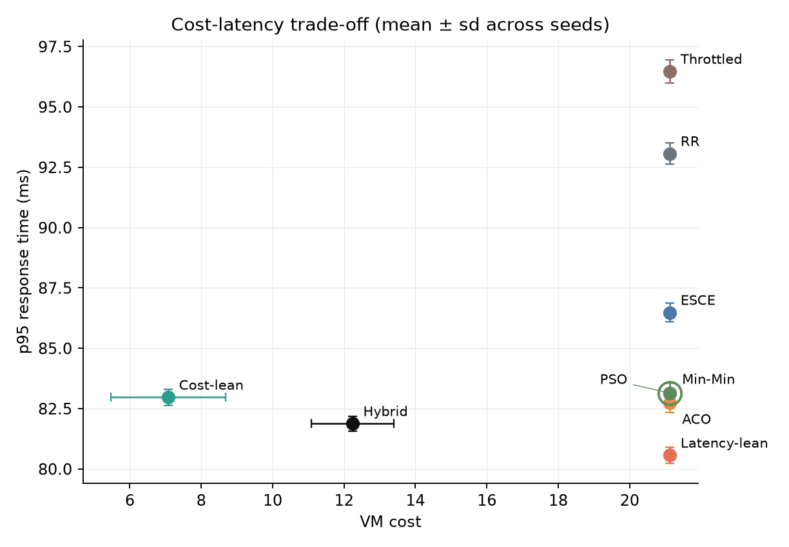

# Online Learning in CloudAnalyst

This document covers the online-learning experiment built on the hybrid
Throttled-ESCE load balancer: a **Hedge policy portfolio** that chooses among nine
load-balancing experts every 15 minutes. A presentation-ready Word version with the
same methodology, figures and result tables is available at
[`Online-Learning-Experiment-Report.docx`](Online-Learning-Experiment-Report.docx).
A summary deck is in [`Online-Learning-Experiment-Slides.pptx`](Online-Learning-Experiment-Slides.pptx).

The short version:

- **Nine load-balancer experts** are evaluated on the same seeded 24-hour workload:
  Round Robin, Throttled, ESCE, Min-Min, Ant Colony (ACO), Particle Swarm (PSO), and
  three configurations of the proposed hybrid (balanced S1, cost-lean S4,
  latency-lean S5).
- **Hedge** reaches a cumulative SLA loss of **72.61**, only **0.18 (0.25%)** above the
  best fixed expert chosen in hindsight (latency-lean, 72.43) and **0.25% better than
  the fixed hybrid**. It beats the other eight experts in **5/5 paired seeds**.
- The empirical static regret is **0.88% of the theoretical Hedge bound** (0.18 versus
  20.54 for K = 9).
- **45 CloudAnalyst runs** (9 experts × 5 paired seeds), 96 fifteen-minute rounds each,
  **303,758 cloudlets** and **30,324,480 requests** per run — identical across policies
  because the Poisson workload generators are seeded (common random numbers).

---

## 1. Research question

A fixed load-balancing policy has to be selected before the workload is known.
CloudAnalyst scenarios contain distinct regimes — off-peak, ramp-up, peak,
cool-down — and no single policy is best on every objective. The experiment asks:

> Can an online learner choose among a portfolio of load-balancing algorithms,
> round by round, and match the best fixed algorithm without being told which one it is?

The experiment is deliberately small and cheap: one scenario, nine experts, five
seeds, and a replay of recorded per-round losses. It is an **offline, full-information**
evaluation of an online learner, not a live closed-loop controller.

---

## 2. Learning formulation

At every 15-minute round `t = 1, …, T` (T = 96), each expert `k` incurs a loss
`ℓ_t(k)`. Hedge maintains a weight `w_t(k)` and selects according to

<p align="center"><b>p<sub>t</sub>(k) = w<sub>t</sub>(k) / Σ<sub>j</sub> w<sub>t</sub>(j)</b></p>

and, after observing the loss vector,

<p align="center"><b>w<sub>t+1</sub>(k) = w<sub>t</sub>(k) · exp(−η · ℓ<sub>t</sub>(k))</b></p>

with the standard learning rate

<p align="center"><b>η = √(8 ln K / T)</b></p>

where `K = 9` and `T = 96`. The losses are divided by 2 before the update so that
they lie in `[0, 1]`; the maximum observed raw loss was 1.77. The theoretical static
regret bound for this setup is `√(T ln K / 2) × 2 ≈ 20.54`.

Two policies are reported:

- **Mixture** — the expected loss `p_t · ℓ_t`, the object of the Hedge bound.
- **Greedy pick** — the single expert with the largest weight, the policy an operator
  would actually deploy.

### Loss

The primary loss is SLA-focused:

<p align="center"><b>ℓ<sub>t</sub>(k) = p95_response_ms(k, t) / 80 + response_sla_rate(k, t)</b></p>

The first term is tail latency relative to the 80 ms SLA; the second is the fraction
of requests above that SLA. Lower is better. VM cost is reported separately because
it is an independent objective; Section 6.6 shows what happens when a cost penalty is
added.

### Why full information?

In an offline replay all experts can be evaluated on the same round, so the learner
observes the full loss vector. A deployed controller that can run only one policy per
request would see bandit feedback and would need EXP3 or a similar algorithm. That is
listed as future work; the present experiment isolates the expert-selection question.

---

## 3. Experts

Nine load-balancer policies, all selectable in the CloudAnalyst **Advanced** tab:

| Label | CloudAnalyst policy | Algorithm |
|---|---|---|
| RR | Round Robin | cyclic allocation over the VM list |
| Throttled | Throttled | state-aware table; queues when all VMs are busy |
| ESCE | Equally Spread Current Execution Load | spreads cloudlets to the least-loaded VM |
| Min-Min | Min Min | immediate-mode Min-Min: assigns each request to the VM with the smallest estimated completion time `(in-flight + 1) / MIPS` |
| ACO | Ant Colony | seeded ant-colony heuristic: pheromone trail × capacity/queue attractiveness, roulette selection, evaporation and deposit on completion |
| PSO | PSO LoadBalancer | seeded particle swarm: each VM is a particle whose position encodes desirability; velocity follows inertia, cognitive and social terms |
| Hybrid (S1) | Proposed Method | scenario 1 preset (L1=30, L2=40, L3=50, idle=120 s) |
| Cost-lean (S4) | Proposed Method | scenario 4 preset (L1=40, L2=55, L3=70, idle=600 s, initial active ratio 0.60) |
| Latency-lean (S5) | Proposed Method | scenario 5 preset (L1=10, L2=20, L3=30, idle=60 s, initial active ratio 1.00) |

The three classic/metaheuristic algorithms are implemented as first-class
`VmLoadBalancer` subclasses with the same queue-aware event hooks as the hybrid:
they observe `EVENT_CLOUDLET_ALLOCATED_TO_VM` and `EVENT_VM_FINISHED_CLOUDLET`, so their
estimates reflect actual in-flight work rather than cumulative allocation counts.
ACO and PSO draw their randomness from a seeded generator, which keeps the paired-seed
comparison valid.

Scenarios 4 and 5 expose a deliberate cost-latency trade-off inside the hybrid policy
family: cost-lean packs work onto fewer active VMs, latency-lean activates the full
pool early.

---

## 4. Simulation setup

Scenario 1 from [`experiments/scenario-1.sim`](../experiments/scenario-1.sim), matching
[`docs/reproducibility.md`](reproducibility.md):

| Item | Value |
|---|---|
| User base | UB1, region R3 |
| Off-peak / peak users | 12,000 / 120,000 |
| Peak window | 01:00–03:00 |
| Requests per user per hour | 60 |
| Data per request | 100 B |
| Data centre | DC1, region R3 |
| VMs | 7 (low / medium / high capacity, 1,000 / 2,000 / 4,000 MIPS) |
| Service broker | Optimise Response Time |
| Duration | 24 hours |
| Grouping factors | 100 users, 100 requests |
| Instruction length | 100 (average of the 150 / 100 / 50 mix) |
| Seeded runs | 5 seeds per expert |

### Measured workload

Every run in the grid produced:

| Metric | Value |
|---|---:|
| Cloudlets (tasks) per run | 303,758 |
| Requests per run | 30,324,480 |
| Rounds | 96 |
| Minimum cloudlets in any 15-minute round | 1,490 |
| Mean cloudlets per round | ~3,164 |

The minimum is above the 1,000-task-per-round requirement. Because the Poisson
workload generators are seeded, the cloudlet and request counts are **identical for
all nine experts at a given seed**, so every expert sees exactly the same demand.

### SLA thresholds used for logging

| Metric | Threshold |
|---|---:|
| End-to-end response time | 80 ms |
| Data-centre processing time | 5 ms |

The 80 ms response threshold is deliberately tight: it produces measurable violations
during the peak (5.6%–21.6%) while remaining at zero off-peak. A 200 ms threshold
produced no violations and could not discriminate between experts.

---

## 5. Protocol

1. Build the project.
2. Run each expert for each seed with the headless runner.
3. Log per-cloudlet processing and per-request response times to CSV.
4. Aggregate into 15-minute rounds.
5. Run Hedge on each seed independently.
6. Average cumulative loss, regret and weights across seeds; report 95% t-based
   confidence intervals (5 seeds, 4 degrees of freedom, t = 2.776).

One JVM is used per simulation because GridSim/SimJava keeps global state.

```bash
./scripts/build.sh
./scripts/run-online-experiment.sh
python -m pip install -r analysis/requirements.txt
python analysis/hedge_experiment.py
```

The driver skips runs whose `summary.csv` is already complete, so it can be resumed.
On Git Bash set `JAVA` and `JAVAC` if the JDK is not on `PATH`:

```bash
JAVA="/c/Program Files/Android/openjdk/jdk-21.0.8/bin/java" \
JAVAC="/c/Program Files/Android/openjdk/jdk-21.0.8/bin/javac" \
./scripts/run-online-experiment.sh
```

Runtime is about 40 seconds per run; the full 45-run grid takes roughly 30 minutes
sequentially and can be split into batches with `EXPERTS=...`.

---

## 6. Results

### 6.1 Fixed-expert quality and cost

Mean ± standard deviation across five seeded runs:

| Expert | Mean response (ms) | p95 response (ms) | SLA violations | Mean processing (ms) | p95 processing (ms) | VM cost | Total cost |
|---|---:|---:|---:|---:|---:|---:|---:|
| Round Robin | 61.92 ± 0.21 | 93.07 ± 0.45 | 14.68% | 7.61 ± 0.17 | 37.43 ± 0.52 | 21.13 ± 0.01 | 312.35 ± 1.98 |
| Throttled | 63.58 ± 0.23 | 96.47 ± 0.48 | 21.57% | 0.31 ± 0.00 | 0.50 ± 0.00 | 21.13 ± 0.01 | 312.35 ± 1.98 |
| ESCE | 60.52 ± 0.19 | 86.49 ± 0.39 | 10.03% | 5.80 ± 0.13 | 25.55 ± 0.51 | 21.13 ± 0.01 | 312.35 ± 1.98 |
| Min-Min | 60.20 ± 0.18 | 83.15 ± 0.40 | 7.96% | 5.36 ± 0.12 | 20.46 ± 0.32 | 21.13 ± 0.01 | 312.35 ± 1.98 |
| Ant Colony (ACO) | 60.18 ± 0.18 | 82.75 ± 0.40 | 7.93% | 5.31 ± 0.12 | 20.13 ± 0.32 | 21.13 ± 0.01 | 312.35 ± 1.98 |
| Particle Swarm (PSO) | 60.21 ± 0.17 | 83.15 ± 0.42 | 7.95% | 5.38 ± 0.12 | 20.44 ± 0.31 | 21.13 ± 0.01 | 312.35 ± 1.98 |
| **Hybrid (S1)** | **59.56 ± 0.15** | **81.88 ± 0.31** | **7.02%** | **3.17 ± 0.03** | **12.49 ± 0.00** | **12.24 ± 1.16** | **303.46 ± 1.10** |
| Hybrid cost-lean (S4) | 59.88 ± 0.16 | 82.97 ± 0.33 | 7.68% | 4.12 ± 0.05 | 17.05 ± 0.05 | **7.08 ± 1.61** | **298.30 ± 2.25** |
| Hybrid latency-lean (S5) | **59.22 ± 0.15** | **80.57 ± 0.33** | **5.59%** | **2.08 ± 0.02** | **7.50 ± 0.00** | 21.13 ± 0.01 | 312.35 ± 1.98 |

Key observations:

- **Throttled** has the lowest processing time but the worst end-to-end response
  (63.58 ms mean, 96.47 ms p95). It keeps VMs lightly loaded by queueing work, so the
  processing metric looks good while users wait. This is why the loss uses end-to-end
  response, not processing time.
- **Min-Min, ACO and PSO** improve on ESCE by 3.3–3.7 ms of p95 and 2.0–2.1 percentage
  points of SLA violations, and they recover most of the hybrid's latency advantage
  without any tuned thresholds. They still pay the full-pool VM cost (21.13).
- **Latency-lean** is the tail-latency winner: 80.57 ms p95 and 5.59% SLA violations.
  It keeps the full 7-VM pool active, so it pays the full VM cost.
- **Cost-lean** cuts VM cost to 7.08 (66% below the full-pool policies) at 82.97 ms p95.
- **Hybrid (S1)** sits between them: 81.88 ms p95 at 12.24 VM cost. It is on the
  cost-latency Pareto front, not the cheapest and not the fastest.

### 6.2 Learner vs fixed experts

| Policy | Cumulative loss | 95% CI | Note |
|---|---:|---|---|
| **Hedge greedy** | **72.61** | [72.48, 72.73] | deployable argmax policy |
| Hedge mixture | 73.64 | [73.51, 73.77] | theoretical Hedge object |
| Uniform mixture | 73.79 | [73.66, 73.92] | no learning |
| Round Robin | 75.52 | [75.38, 75.66] | |
| Throttled | 76.79 | [76.66, 76.91] | |
| ESCE | 73.84 | [73.71, 73.97] | |
| Min-Min | 73.25 | [73.11, 73.38] | |
| Ant Colony (ACO) | 73.13 | [72.98, 73.28] | |
| Particle Swarm (PSO) | 73.27 | [73.13, 73.41] | |
| Hybrid (S1) | 72.79 | [72.67, 72.91] | |
| Hybrid cost-lean (S4) | 73.08 | [72.97, 73.20] | |
| Hybrid latency-lean (S5) | **72.43** | [72.30, 72.56] | best fixed in hindsight (5/5 seeds) |
| Per-round oracle | 72.40 | [72.27, 72.52] | unattainable lower bound |

Paired by seed, the greedy learner:

- beats Round Robin in **5/5** seeds by 2.92 loss units (3.85%),
- beats Throttled in **5/5** seeds by 4.18 units (5.44%),
- beats ESCE in **5/5** seeds by 1.23 units (1.66%),
- beats Min-Min in **5/5** seeds by 0.64 units (0.87%),
- beats ACO in **5/5** seeds by 0.53 units (0.72%),
- beats PSO in **5/5** seeds by 0.66 units (0.90%),
- beats the fixed hybrid in **5/5** seeds by 0.185 units (0.25%),
- beats cost-lean in **5/5** seeds by 0.476 units (0.64%),
- trails latency-lean in **5/5** seeds by 0.179 units (0.25%).

The mixture is worse than the greedy pick and slightly worse than the three
classic algorithms because it spreads weight across nine near-equivalent experts. In
Hedge theory the mixture is the object with the regret bound; in deployment the argmax
policy is the relevant one.

### 6.3 Regret and convergence

| Policy | Static regret | 95% CI | Dynamic regret | 95% CI |
|---|---:|---|---:|---|
| Hedge greedy | **+0.18** | [0.17, 0.18] | **0.21** | [0.21, 0.22] |
| Hedge mixture | +1.21 | [1.19, 1.23] | 1.24 | [1.23, 1.26] |

The theoretical static-regret bound is about 20.54 for K = 9. The greedy policy's
empirical regret is **0.88% of the bound**. The regret is not spread evenly: it rises
during rounds 5–12, the two-hour peak, and then stays flat for the remaining 84 rounds.
Off-peak, all experts have essentially the same loss (0.717 each), so there is nothing
left to learn until the next regime change.







The weight chart shows the same story: the learner moves weight toward latency-lean
during the peak and keeps it there. Final mean weights are approximately latency-lean
0.14, hybrid 0.13, cost-lean 0.12, ACO 0.12, Min-Min 0.12, PSO 0.12, ESCE 0.11,
Round Robin 0.08, Throttled 0.06.



Across all five seeds, the greedy policy selects Round Robin, Throttled or ESCE during
the first few rounds and then latency-lean from round 5 onward. It does not switch back
because off-peak losses are identical; switching would not improve the objective.

### 6.4 Cost-latency trade-off



| Configuration | VM cost | p95 response | Position |
|---|---:|---:|---|
| Cost-lean (S4) | 7.08 | 82.97 ms | cheapest |
| Hybrid (S1) | 12.24 | 81.88 ms | balanced |
| Latency-lean (S5) | 21.13 | 80.57 ms | fastest tail |

The three hybrid configurations trace a Pareto front. The three classic algorithms and
the three baseline policies all sit at the full-pool cost (21.13); ACO is the best of
them on tail latency, but none matches the tuned hybrid family on either objective.

Moving from cost-lean to latency-lean buys 2.4 ms of p95 response for 14.05 extra VM
cost units. The fixed hybrid buys 1.09 ms for 5.16 units; latency-lean buys the last
1.31 ms for 8.89 units. The diminishing returns are visible.

### 6.5 Peak vs off-peak

| Expert | Off-peak loss | Peak loss | Change | Final weight |
|---|---:|---:|---:|---:|
| Round Robin | 0.718 | 1.538 | +114% | 0.076 |
| Throttled | 0.717 | 1.709 | +138% | 0.059 |
| ESCE | 0.717 | 1.342 | +87% | 0.106 |
| Min-Min | 0.718 | 1.263 | +76% | 0.120 |
| ACO | 0.718 | 1.246 | +74% | 0.123 |
| PSO | 0.718 | 1.263 | +76% | 0.120 |
| Hybrid (S1) | 0.717 | 1.208 | +68% | 0.131 |
| Cost-lean (S4) | 0.717 | 1.244 | +74% | 0.124 |
| Latency-lean (S5) | 0.717 | 1.162 | +62% | 0.142 |

The peak is where the experts separate. Latency-lean has the lowest peak loss, but the
learner's mixture weights move only modestly because the peak is short and the loss
gaps are small. The greedy policy still identifies latency-lean and keeps it.

### 6.6 Loss and cost-weight sensitivity

Changing the loss definition does not change the ranking:

| Loss | Greedy cumulative loss | Best fixed | Greedy static regret | Best fixed expert |
|---|---:|---:|---:|---|
| `p95/80 + SLA` (primary) | 72.61 | 72.43 | +0.18 | Latency-lean |
| `mean/50 + SLA` | 103.48 | 102.37 | +1.11 | Latency-lean |
| `p95/80` only | 72.07 | 71.49 | +0.58 | Latency-lean |
| `0.5·mean/50 + 0.5·p95/80 + SLA` | 88.56 | 87.40 | +1.16 | Latency-lean |

Adding an amortised VM-cost penalty shifts the selected expert, as expected:

| Cost weight λ | Greedy loss | Best fixed | Best fixed selected | Final top expert |
|---:|---:|---|---|---|
| 0.0 | 72.61 | 72.43 | Latency-lean (5/5) | Latency-lean |
| 0.1 | 73.82 | 73.77 | Cost-lean (4/5), Hybrid (1/5) | Cost-lean |
| 0.25 | 74.94 | 74.85 | Cost-lean (5/5) | Cost-lean |
| 0.5 | 76.70 | 76.62 | Cost-lean (5/5) | Cost-lean |
| 1.0 | 80.31 | 80.16 | Cost-lean (5/5) | Cost-lean |
| 2.0 | 87.54 | 87.24 | Cost-lean (5/5) | Cost-lean |

The cost penalty here is amortised (`vm_cost / 96` per round), not a dynamic per-round
price. It is a sensitivity check, not the primary objective. The result is intuitive:
as the operator's cost weight rises, the learner moves from latency-lean to cost-lean
while keeping regret small.

---

## 7. Interpretation

1. **The learner matches the best fixed load balancer without being told which one it
   is.** The greedy policy is 0.25% behind latency-lean and beats the other eight
   experts, with 5/5 paired wins over each. The exploration cost is 0.18 loss units,
   0.88% of the theoretical bound.
2. **The portfolio spans three algorithm families.** Stateless baselines (RR, Throttled,
   ESCE), classic/metaheuristic balancers (Min-Min, ACO, PSO) and the hybrid family
   compete on the same trace. The hybrid family supplies the useful experts; the
   classic algorithms are strong when the pool is fully active but cannot scale it down.
3. **Classic algorithms are competitive on latency, not on cost.** Min-Min, ACO and PSO
   beat ESCE but land 1.3–2.6 ms behind latency-lean on p95 and pay 21.13 VM units
   against 7.08–12.24 for the hybrid presets.
4. **The scenario has one dominant regime change.** Off-peak, all experts are
   equivalent; the peak is the only place where learning matters. This is why the
   regret curve is a step, not a gradual slope.
5. **The objective determines the winner.** With an SLA-focused loss, latency-lean
   wins. With a cost penalty, cost-lean wins. The online learner follows the operator's
   loss function; this is the point of the meta-policy.
6. **Throttled's low processing time is misleading.** It queues work, so processing
   time falls while end-to-end response rises. Always evaluate the SLA, not the
   internal processing metric.

---

## 8. Limitations and threats to validity

- **The experiment is an offline, full-information replay.** The learner observes all
  expert losses; a deployed controller would see bandit feedback and would need EXP3
  or a similar algorithm.
- **One scenario, one peak.** Scenario 1 has a single 01:00–03:00 peak. A workload
  with multiple peaks or drift would test adaptation more strongly.
- **Five seeds.** The paired confidence intervals are tight because the simulator is
  seeded, but five seeds is a small sample. Extend with
  `SEEDS="1 2 3 4 5 6 7 8 9 10"`.
- **Loss choice.** The primary loss weights p95 and SLA violations; other operators
  may weight mean response or cost differently. Section 6.6 reports sensitivity.
- **Amortised cost sensitivity.** The cost-weight table uses total VM cost divided by
  96, not a per-round price trace. A per-round cost logger would make the cost-aware
  learner more realistic.
- **Headless execution.** The runs use the same `Simulation.runSimulation()` path as
  the GUI but bypass the Swing configuration screen. The archived GUI reports in
  `results/scenario-*` remain the reference for the original scenarios.
- **Single data centre.** Scenario 1 has one DC, so broker-level DC selection is
  constant. Scenarios 2 and 3 would add a second learning dimension (DC choice).

---

## 9. Reproducing the artifacts

```bash
# 1. Build
./scripts/build.sh

# 2. Run the 9 experts × 5 seeds grid (about 30 minutes)
./scripts/run-online-experiment.sh

# 3. Install analysis dependencies and generate figures/tables
python -m pip install -r analysis/requirements.txt
python analysis/hedge_experiment.py
```

Useful environment variables for the driver:

| Variable | Default | Meaning |
|---|---|---|
| `SEEDS` | `1 2 3 4 5` | seeds to run |
| `EXPERTS` | all nine labels | subset, e.g. `EXPERTS="rr hybrid pso"` |
| `SIM` | `experiments/scenario-1.sim` | scenario file |
| `OUT_ROOT` | `results/online` | output root |
| `SLA_MS` | `80` | response SLA for logging |
| `PROC_SLA_MS` | `5` | processing SLA for logging |
| `HEAP` | `-Xmx3g` | JVM heap |

Each run writes:

```text
results/online/<expert>/seed-<n>/
├── rounds.csv          # 96 rows of per-round metrics
├── summary.csv         # one row of run totals and costs
├── tasks_sample.csv    # up to 2,000 sampled cloudlets/responses
└── run.log             # console log with RUN_START / RUN_COMPLETE
```

The analysis writes:

```text
analysis/output/
├── summary.json
├── RESULTS.md
├── figures/fig01..fig09
└── tables/table1..table8
```

---

## 10. Presentation script

1. **Problem.** A fixed load balancer must be chosen before the workload is known;
   latency and cost pull in different directions.
2. **Portfolio.** Nine load-balancing algorithms compete every 15 minutes: RR,
   Throttled, ESCE, Min-Min, ACO, PSO and three hybrid configurations.
3. **Method.** Hedge reweights experts by observed SLA loss
   (`p95/80 + violation rate`), with `η = √(8 ln 9 / 96)`.
4. **Setup.** Scenario 1, 24 hours, 303,758 tasks per run, 9 experts × 5 paired seeds.
5. **New experts.** Min-Min assigns by estimated completion time; ACO uses pheromone ×
   capacity/queue attractiveness; PSO evolves per-VM desirability. All three are
   queue-aware and seeded.
6. **Result.** Greedy Hedge reaches 72.61 versus 72.43 for the best fixed expert and
   72.79 for the fixed hybrid; it wins 5/5 seeds against all eight other experts.
   Empirical regret is 0.88% of the theoretical bound.
7. **Trade-off.** Latency-lean wins the SLA-focused loss; cost-lean wins once a cost
   penalty is added. The hybrid family occupies the Pareto front.
8. **Takeaway.** Online expert selection tracks the best load balancer without being
   told which one it is, and the hybrid remains the best balanced expert.

---

## 11. Files and code

| Path | Purpose |
|---|---|
| [`experiments/scenario-1.sim`](../experiments/scenario-1.sim) | scenario input |
| [`src/cloudsim/ext/experiment/HeadlessSimulationRunner.java`](../src/cloudsim/ext/experiment/HeadlessSimulationRunner.java) | one-run CLI |
| [`src/cloudsim/ext/experiment/ExperimentMetrics.java`](../src/cloudsim/ext/experiment/ExperimentMetrics.java) | per-round CSV logger |
| [`src/cloudsim/ext/experiment/ExperimentSettings.java`](../src/cloudsim/ext/experiment/ExperimentSettings.java) | system-property settings |
| [`src/cloudsim/ext/datacenter/MinMinVmLoadBalancer.java`](../src/cloudsim/ext/datacenter/MinMinVmLoadBalancer.java) | queue-aware Min-Min |
| [`src/cloudsim/ext/datacenter/AntColonyVmLoadBalancer.java`](../src/cloudsim/ext/datacenter/AntColonyVmLoadBalancer.java) | seeded ACO |
| [`src/cloudsim/ext/datacenter/PSOVmLoadBalancer.java`](../src/cloudsim/ext/datacenter/PSOVmLoadBalancer.java) | seeded PSO |
| [`src/cloudsim/ext/datacenter/ProposedMethodLoadBalancer.java`](../src/cloudsim/ext/datacenter/ProposedMethodLoadBalancer.java) | hybrid policy |
| [`scripts/run-online-experiment.sh`](../scripts/run-online-experiment.sh) | 9 × 5 grid driver |
| [`analysis/hedge_experiment.py`](../analysis/hedge_experiment.py) | Hedge, tables, figures |
| [`analysis/output/`](../analysis/output) | generated results |

---

## 12. Citation note

If you use this experiment, cite the repository and the CloudAnalyst/CloudSim papers
listed in [`CITATION.cff`](../CITATION.cff). The Hedge algorithm is described in
Mohri, Rostamizadeh and Talwalkar, *Foundations of Machine Learning*, Chapter 1
(On-Line Learning).
