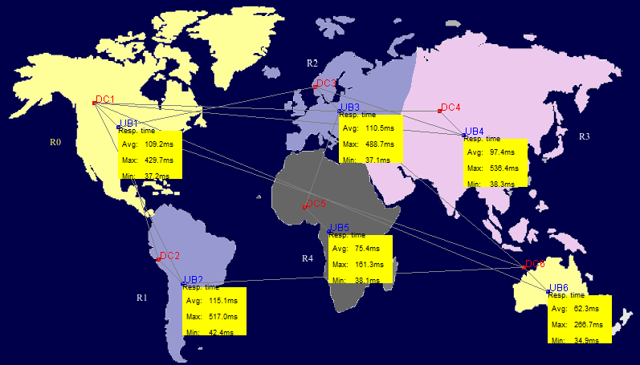
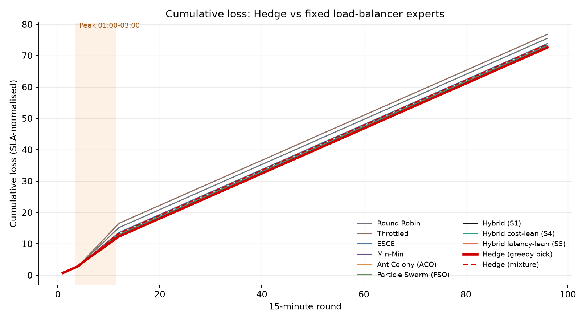

# Results

All values are from the CloudAnalyst reports archived in [`results/`](../results). Times are in milliseconds; costs are in US dollars.

*Response-time map from a 24-hour scenario-3 run: six user bases served by six data centres, with average, maximum and minimum response time per user base.*

---

## Aggregate improvements

Relative to the ESCE and Throttled baselines across the three scenarios:

| Metric | Improvement |
|---|---:|
| Average processing time | **-32.56%** |
| Average response time | **-8.05%** |
| VM cost | **-53.03%** |
| Total cost (VMs + data transfer) | **-4.36%** |
| Requests routed to high-capacity VMs | **> 44.39%** |

The cost reduction comes from elastic down-scaling: high-capacity VMs are returned to standby during off-peak periods, while low- and medium-capacity VMs remain available for cheap burst absorption.

---

## Processing time

| Scenario | Policy | Average | Min | Max |
|---|---|---:|---:|---:|
| 1 | RR | 8.23 | 0.04 | 57.50 |
| 1 | ESCE | 6.42 | 0.04 | 46.87 |
| 1 | TLB | 10.28 | 0.04 | 51.60 |
| 1 | **Hybrid** | **5.16** | 0.04 | **27.64** |
| 2 | RR | 11.15 | 0.06 | 55,537.92 |
| 2 | ESCE | 9.18 | 0.06 | 227.44 |
| 2 | TLB | 17.67 | 0.06 | 101.75 |
| 2 | **Hybrid** | **8.61** | 0.06 | 105.29 |
| 3 | RR | 23.90 | 0.03 | 57,168.12 |
| 3 | ESCE | 15.26 | 0.03 | 61,434.60 |
| 3 | TLB | 26.89 | 0.03 | 239.69 |
| 3 | **Hybrid** | **12.81** | 0.03 | 371.94 |

---

## Response time

| Scenario | Policy | Average | Min | Max |
|---|---|---:|---:|---:|
| 1 | RR | 62.09 | 36.72 | 120.77 |
| 1 | ESCE | 60.69 | 36.72 | 109.92 |
| 1 | TLB | 63.80 | 36.72 | 122.52 |
| 1 | **Hybrid** | **59.70** | 36.72 | **101.06** |
| 2 | RR | 86.65 | 35.73 | 55,593.60 |
| 2 | ESCE | 80.01 | 35.38 | 407.47 |
| 2 | TLB | 72.35 | 35.38 | 364.15 |
| 2 | **Hybrid** | **64.77** | 35.38 | **363.54** |
| 3 | RR | 121.37 | 34.92 | 57,113.27 |
| 3 | ESCE | 110.33 | 34.92 | 61,481.24 |
| 3 | TLB | 108.97 | 34.92 | 508.14 |
| 3 | **Hybrid** | **103.80** | 34.92 | 528.36 |

In the most demanding scenario the hybrid has a marginally higher maximum response time than TLB (528.36 ms vs 508.14 ms). This is attributable to counting tasks rather than their computational weight: a few heavy tasks on one VM can create a short-lived outlier.

---

## Load distribution

Share of requests routed to each VM class (LC = low, MC = medium, HC = high capacity):

| Scenario | Policy | LC | MC | HC |
|---|---|---:|---:|---:|
| 1 | **Hybrid** | 26.10% | 31.50% | **42.40%** |
| 1 | TLB | 48.99% | 30.41% | 20.60% |
| 1 | ESCE | 34.64% | 31.05% | 34.31% |
| 1 | RR | 42.86% | 28.57% | 28.57% |
| 2 | **Hybrid** | 18.37% | 36.07% | **45.56%** |
| 2 | TLB | 37.37% | 34.35% | 28.28% |
| 2 | ESCE | 29.73% | 35.02% | 35.25% |
| 2 | RR | 33.33% | 33.33% | 33.33% |
| 3 | **Hybrid** | 21.56% | 33.23% | **45.21%** |
| 3 | TLB | 36.87% | 34.78% | 28.35% |
| 3 | ESCE | 25.17% | 34.40% | 40.43% |
| 3 | RR | 33.98% | 33.29% | 32.73% |

The hybrid consistently routes the largest share to high-capacity VMs while keeping a low-capacity base for cheap demand, which is the intended exploitation of heterogeneity.

---

## Cost

| Scenario | Policy | VM cost | Data transfer | Total |
|---|---|---:|---:|---:|
| 1 | Baseline | 21.13 | 289.98 | 311.10 |
| 1 | **Hybrid** | **12.51** | 289.98 | **302.49** |
| 2 | Baseline | 114.73 | 1,350.50 | 1,465.23 |
| 2 | **Hybrid** | **54.98** | 1,350.50 | **1,405.47** |
| 3 | Baseline | 483.85 | 4,650.90 | 5,134.76 |
| 3 | **Hybrid** | **163.48** | 4,650.90 | **4,814.38** |

Data-transfer cost is workload-driven and therefore identical between policies; the savings come entirely from the VM pool. Because data transfer dominates total cost in these scenarios, the relative total-cost saving (4.36%) is much smaller than the VM-cost saving (53.03%).

---

## Online-learning comparison (scenario 1, seeded headless runs)

Nine load-balancer policies, five paired seeds, identical 24-hour workload. Hedge
selects among the fixed policies every 15 minutes; the hybrid remains the balanced
cost-latency winner.

| Policy | Mean response (ms) | p95 response (ms) | SLA violations | VM cost | Cumulative loss |
|---|---:|---:|---:|---:|---:|
| Round Robin | 61.92 | 93.07 | 14.68% | 21.13 | 75.52 |
| Throttled | 63.58 | 96.47 | 21.57% | 21.13 | 76.79 |
| ESCE | 60.52 | 86.49 | 10.03% | 21.13 | 73.84 |
| Min-Min | 60.20 | 83.15 | 7.96% | 21.13 | 73.25 |
| Ant Colony (ACO) | 60.18 | 82.75 | 7.93% | 21.13 | 73.13 |
| Particle Swarm (PSO) | 60.21 | 83.15 | 7.95% | 21.13 | 73.27 |
| **Hybrid (S1)** | **59.56** | **81.88** | **7.02%** | **12.24** | 72.79 |
| Hybrid cost-lean (S4) | 59.88 | 82.97 | 7.68% | **7.08** | 73.08 |
| Hybrid latency-lean (S5) | **59.22** | **80.57** | **5.59%** | 21.13 | **72.43** |
| Hedge (greedy pick) | — | — | — | — | **72.61** |

Hedge lands 0.18 loss units (0.25%) above the best fixed expert chosen in hindsight
and beats the other eight experts in 5/5 paired seeds; empirical regret is 0.88% of the
theoretical bound.

Full protocol and paired tests: [online-learning-experiment.md](online-learning-experiment.md).

---

## Archived CloudAnalyst reports

| Scenario | Proposed | Throttled | ESCE | RR |
|---|---|---|---|---|
| 1 | [proposed.pdf](../results/scenario-1/proposed.pdf) | [throttled.pdf](../results/scenario-1/throttled.pdf) | [esce.pdf](../results/scenario-1/esce.pdf) | [rr.pdf](../results/scenario-1/rr.pdf) |
| 2 | [proposed.pdf](../results/scenario-2/proposed.pdf) | [throttled.pdf](../results/scenario-2/throttled.pdf) | [esce.pdf](../results/scenario-2/esce.pdf) | [rr.pdf](../results/scenario-2/rr.pdf) |
| 3 | [proposed.pdf](../results/scenario-3/proposed.pdf) | [throttled.pdf](../results/scenario-3/throttled.pdf) | [esce.pdf](../results/scenario-3/esce.pdf) | [rr.pdf](../results/scenario-3/rr.pdf) |

Console logs from the runs are grouped by scenario in [`results/logs/`](../results/logs).
